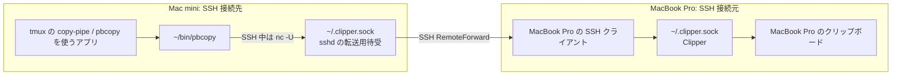
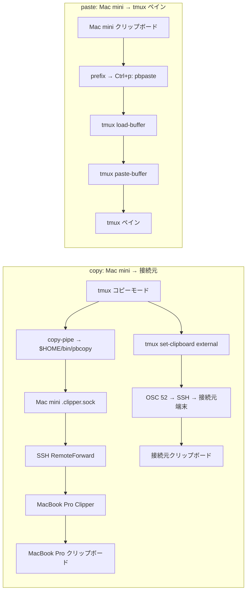
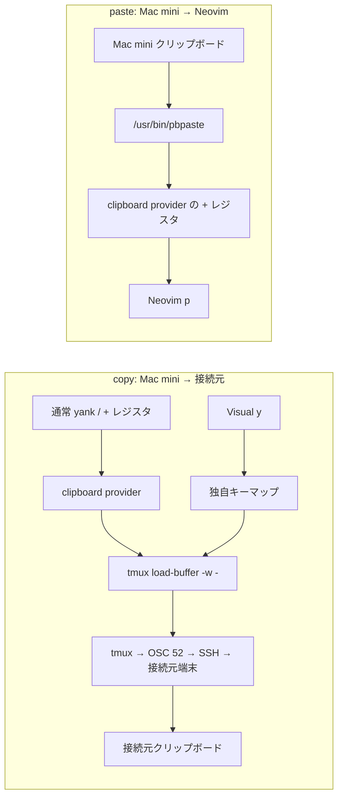
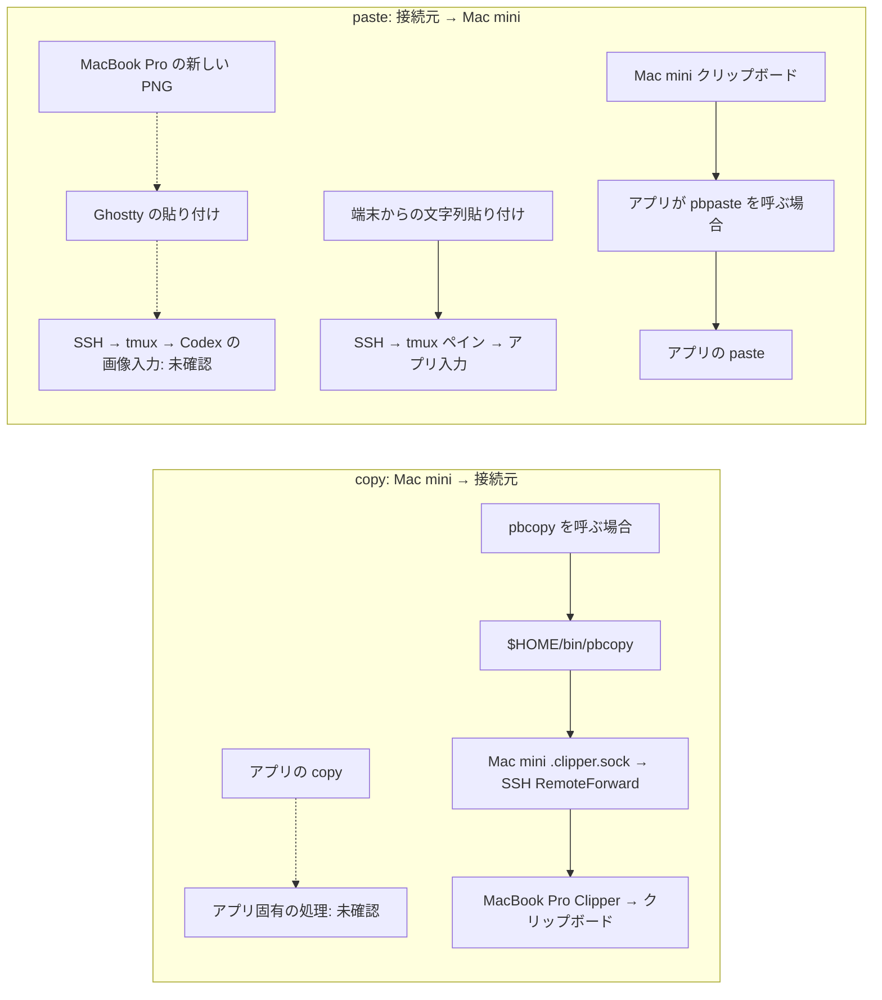

# ADR 0001: SSH 中の画像貼り付けと copy/yank を両立させる

- 日付: 2026-11-09、改定: 2026-11-10
- 状態: 検証中

## 目的

SSH 中に、接続元（host）から Mac mini（remote）への画像貼り付けと、Mac mini から接続元への copy/yank を、Neovim・tmux・Codex などで両立させる。文字列のコピーだけを成功条件としない。

## 現時点の決定

現在の実装は、Mac mini の tmux コピーモードが Clipper 対応の `$HOME/bin/pbcopy` を使い、SSH 中の Neovim が copy に `tmux load-buffer -w -`、テキスト paste に Mac mini の `/usr/bin/pbpaste` を使う構成である。tmux の `prefix → Ctrl+p` は `pbpaste | tmux load-buffer - && tmux paste-buffer`。Neovim の copy は MacBook Pro に届かないことを利用者が確認しており、この構成を最終決定とはしない。

利用者の前提は、11月6日以降の変更前には MacBook Pro から Mac mini の Neovim への画像貼り付けが機能し、外部条件の差分は厳密にゼロ、というもの。回帰の原因を Git 履歴の差分から導く。以前の成功を `pngpaste` の一般的な仕様や新しい転送方式の必要性で否定しない。

## Clipper を介した Mac mini → MacBook Pro の通信

SSH の Unix domain socket 転送が成立しているとき、文字列 copy は次の順序で流れる。両機の `~/.ssh/config` は iCloud 同期で同一だが、`Host mini` または `Host vpn` の `RemoteForward` を実行するのは接続元の MacBook Pro の SSH クライアントである。

`RemoteForward /Users/t-akira012/.clipper.sock /Users/t-akira012/.clipper.sock` は、左側の Mac mini のソケットへの接続を、右側の MacBook Pro の Clipper ソケットへ運ぶ。mini の `$HOME/bin/pbcopy` は、ホスト名が `m4mini-prv`、SSH 環境変数があり、同パスがソケットなら `nc -U` で送る。送信が失敗した場合はエラーにし、ソケットがなければ macOS の `/usr/bin/pbcopy` に進む。

mini 自身の Clipper サービスも `~/.clipper.sock` を使う。mini の `/etc/ssh/sshd_config` にある `StreamLocalBindUnlink yes` は、転送を張る際にその既存パスを外して SSH の待受を作れるようにする設定である。Clipper のプロセスが起動中であることと、パスへの接続が MacBook Pro へ転送されることは同義ではない。SSH の待受がパスを持てば上図の経路、mini の Clipper がパスを持てば mini 自身のクリップボードへの経路になる。どちらがその時点でパスを待ち受けるかはソケットの所有プロセスで判定する。今回の追加確認時点では `lsof` に mini の Clipper の待受だけが表示され、SSH の転送用待受は表示されなかった。この観測を画像貼り付けの回帰原因とは扱わない。

tmux にはこれと独立した OSC 52 の copy 経路もある。Neovim の現行 `tmux load-buffer -w -` は上図の `~/bin/pbcopy` を呼ばない。また、図は mini → MacBook Pro の copy の流れであり、MacBook Pro → mini の画像貼り付けのデータ経路を示すものではない。

## 議論と経過

表の copy は Mac mini → 接続元、paste は接続元 → Mac mini。paste 欄は tmux の `prefix → Ctrl+p`、Neovim の `p`、Codex の画像添付など、各アプリ内の操作を指す。端末自身の貼り付けキーは別経路である。「未確認」は設定から結果を推測しないことを示す。

### 11月5日: 変更前（`dotfiles` commit `db47219`）

| 対象 | copy 経路 | copy 結果 | paste 経路 | paste 結果 |
| --- | --- | --- | --- | --- |
| tmux | `copy-pipe` → `pbcopy`。旧 `pbcopy` は条件が合えば Clipper ソケットへ送る。tmux の `set-clipboard` による OSC 52 も利用可能 | 接続元への到達は未確認 | `prefix → Ctrl+p` → Mac mini の `pbpaste` → tmux バッファ → ペイン | 接続元からの到達は未確認 |
| Neovim | `clipboard=unnamedplus` の macOS provider → `pbcopy`。Visual `y` は独自に `pbcopy` を呼ぶ | 接続元への到達は未確認 | `+` レジスタの macOS provider → `pbpaste` | 接続元からの到達は未確認 |
| Codex など | アプリ固有。旧 dotfiles は共通の copy を強制しない | 未確認 | アプリ固有。旧 dotfiles は画像入力を実装しない | この時点の個別結果は未確認 |

### 11月7日～Clipper 排除前（`dotfiles` commit `680bd6c` 以降）

| 対象 | copy 経路 | copy 結果 | paste 経路 | paste 結果 |
| --- | --- | --- | --- | --- |
| tmux | コピーモード → `$HOME/bin/pbcopy` → Clipper ソケットを優先。tmux の OSC 52 も利用可能 | 接続元へのコピーを利用者が報告 | `prefix → Ctrl+p` → Mac mini の `pbpaste` → tmux バッファ → ペイン | 設定は11月5日から不変。個別結果は未確認 |
| Neovim | macOS provider／Visual `y` → `pbcopy` → Clipper ソケットを優先 | 接続元への到達は未確認 | `+` レジスタ → `pbpaste` | 個別結果は未確認 |
| Codex など | アプリ固有 | 未確認 | アプリ固有の画像入力 | Ghostty（MacBook Pro）→ SSH → Mac mini → tmux → Codex で PNG 貼り付け成功を利用者が報告 |

### 11月9日: Clipper 排除後（`dotfiles` commit `d18004f`、`kickstart.nvim` commit `d59ffef`）

| 対象 | copy 経路 | copy 結果 | paste 経路 | paste 結果 |
| --- | --- | --- | --- | --- |
| tmux | コピーモードの OSC 52、および `pbcopy` → `tmux load-buffer -w -` | 接続元への文字列コピーを確認 | `prefix → Ctrl+p` → Mac mini の `pbpaste` → tmux バッファ → ペイン | 設定は不変。画像については未確認 |
| Neovim | SSH 中の `tmux` provider／Visual `y` → `tmux load-buffer -w -` → OSC 52 | Windows 11 で yank → 接続元への貼り付けを利用者が確認 | `tmux` provider → tmux バッファ。以前の `pbpaste` から変更された | 接続元からの paste は未確認 |
| Codex など | アプリ固有 | 未確認 | アプリ固有の画像入力 | 新しい PNG が届かないと利用者が報告。古い画像の添付は新しい転送の証拠にならない |

### 11月10日: Clipper 復旧と copy/paste 分離（追加調査前の構成）

| 対象 | copy 経路 | copy 結果 | paste 経路 | paste 結果 |
| --- | --- | --- | --- | --- |
| tmux | OSC 52。`copy-pipe` の `pbcopy` は復旧した Clipper ソケットも使う | `pbcopy` → SSH ソケット転送 → MacBook Pro のクリップボードは文字列で確認済み。tmux コピーモードからの併用結果は未確認 | 従来どおり Mac mini の `pbpaste` → tmux バッファ → ペイン | 新しい画像と文字列で未確認 |
| Neovim | SSH 中は `tmux load-buffer -w -` → OSC 52。Visual `y` も同経路 | 新しい構成では未確認 | カスタム provider → Mac mini の `/usr/bin/pbpaste` | 新しい構成では未確認 |
| Codex など | アプリ固有 | 未確認 | アプリ固有の画像入力 | 新しい識別可能な PNG で未確認 |

### 現在の copy / paste 経路

MacBook Pro から Mac mini に SSH 接続した場合を描く。実線は設定から追える文字列の経路、点線はアプリ固有で実際の到達をまだ確認していない経路。`pbpaste` は Mac mini のクリップボードを読み、MacBook Pro のクリップボードを直接読み取るわけではない。

#### tmux

#### Neovim

#### その他のアプリ（Codex・シェルなど）

Mac mini では Clipper 3.0.0 を Homebrew から再導入し、launchd の `sh.brew.clipper` が `~/.clipper.sock` を待ち受けることを確認した。MacBook Pro 側にも Clipper 3.0.0 を導入した。MacBook Pro の SSH 設定には `Host mini` と `Host vpn` のそれぞれに Clipper 用 `RemoteForward` と `StreamLocalBindUnlink yes` があり、Mac mini の `sshd_config` にも `StreamLocalBindUnlink yes` がある。Mac mini 側で SSH が転送ソケットを待ち受け、Mac mini の `pbcopy` から MacBook Pro のクリップボードへの文字列到達を確認した。tmux 3.8、`set-clipboard external`、`Ms` 機能も確認済み。Clipper の公開文書は従来のソケット経路をテキスト向けと説明しているため、画像貼り付けとの因果関係は新しい画像で検証する。OSC 52 も文字列の copy 経路であり、単独で画像貼り付けを実現しない。

### 11月10日: Git 履歴からの回帰分析

**前提。** 利用者は、11月6日以降の変更前に画像貼り付けが機能していたこと、現在は Mac mini の Neovim yank が MacBook Pro に届かない一方で tmux の copy は届くこと、Mac mini と MacBook Pro の `~/.ssh/config` が iCloud 同期で同一であることを確認した。外部条件の差分は厳密にゼロとして固定する。以下の推論に外部経路の変化を加えない。

| 日付・コミット | Git で確認できる差分 | この問題との関係 |
| --- | --- | --- |
| 11月7日 `dotfiles` `680bd6c` | tmux の copy を Clipper 対応 `$HOME/bin/pbcopy` に統一 | 現在も tmux はこのコマンドを使い、MacBook Pro への copy が成功する |
| 11月8日 `kickstart.nvim` `6f3716f` | Visual `y` の Windows 分岐を追加 | Mac mini の macOS 分岐と画像貼り付け処理は変更しない |
| 11月9日 `kickstart.nvim` `d59ffef` | SSH 中の `vim.g.clipboard` を `tmux` にし、Visual `y` の送信先を `pbcopy` から `tmux load-buffer -w -` に変更 | Neovim の copy/paste 経路が以前の macOS provider から初めて変わる |
| 11月9日 `dotfiles` `d18004f` | Clipper 対応 `pbcopy` とインストールスクリプトを削除し、SSH 中の `pbcopy` を `tmux load-buffer -w -` に変更 | Clipper 排除時の差分。tmux の `prefix → Ctrl+p` と Neovim の `:PasteImage` は変更しない |
| 11月10日 `kickstart.nvim` `7b87446` | Neovim の copy を `tmux load-buffer -w -`、テキスト paste を `/usr/bin/pbpaste` とするカスタム provider に変更 | copy の変更は残り、paste の実装は再度変わる |
| 11月10日 `dotfiles` `46198d9` | Clipper 対応 `pbcopy` を復旧 | 現在の tmux の成功経路は復旧済み。Neovim の copy は引き続き別経路 |

**差分による絞り込み。** `680bd6c` と現在の `dotfiles` を比較すると、`root/bin/pbcopy` の実行内容と tmux の copy キーのコマンドは同じである。`6f3716f` と現在の `kickstart.nvim` を比較すると、画像保存の `sh/paste_image*.sh` と `lua/functions.lua` の `:PasteImage` は変わらない。変わったのは `lua/options.lua` の clipboard provider と、`lua/keymaps.lua` の Visual `y` の送信先だけである。後者は yank 専用なので画像貼り付けの説明には使えない。外部差分をゼロと固定したとき、Neovim の画像貼り付けの前後差を説明する残存差分は `d59ffef` で導入され `7b87446` で再構成された `lua/options.lua` の provider 設定である。`pngpaste` の仕様や `2222` の状態を回帰原因に置くのは、この差分と対応しない。

文字列 yank では、tmux の成功経路が `pbcopy` で変わらない一方、Neovim の copy provider と Visual `y` の明示的な送信先は `pbcopy` から `tmux load-buffer -w -` に変わった。この変更が両者の結果差に対応する。画像データの形式を推測しなくても、どの設定差分を戻すべきかは特定できる。

Visual `y` には独立した問題もある。現行マッピングは yank 後に `vim.fn.getreg(register)` を呼ぶ。`clipboard=unnamedplus` と現在の paste provider の組み合わせでは、隔離した tmux で選択文字列 `ab` ではなく Mac mini の既存クリップボード文字列が再送されることを再現した。これは Neovim 内の文字列の取り違えを示す。MacBook Pro への送信経路の問題と分けて扱う。試験的な Neovim コード変更は元に戻してあり、実装は変更していない。

## 次のステップ

1. Neovim の修正案は、`lua/options.lua` の provider を画像貼り付けが動いていた構成へ戻し、copy を成功している tmux と同じ `$HOME/bin/pbcopy` 経路に揃える。Visual `y` の再読込問題も解消する。実装はこの ADR の分析が確定するまで変更しない。
2. 修正前後に MacBook Pro 側で通常の `y` と Visual `y` の文字列、新しい画像の到達をそれぞれ確認する。`pbpaste` や `pngpaste` の一般的な能力から以前の成功を否定しない。
3. Codex の画像添付と Windows 11 からの貼り付けは、Neovim の回帰とは別に記録する。過去の画像を新しい転送の成功と数えない。
4. MacBook Pro で新しい識別可能な PNG をコピーし、Ghostty → SSH → tmux → Codex に貼り付ける。同時に Mac mini 側の Clipper ソケットと画像クリップボードの状態を確認する。
5. Windows 11 → Mac mini でも文字列と画像を確認する。Windows では Clipper の導入と SSH 設定をまだ行っていない。
6. tmux・Neovim・Codex の結果を確認した後、最終構成をこの ADR に記録する。`tmux load-buffer -w` には tmux 3.2 以上と接続元端末の OSC 52 対応が必要。

## 参照

- [tmux Clipboard Wiki](https://github.com/tmux/tmux/wiki/Clipboard)
- [Neovim clipboard provider](https://neovim.io/doc/user/provider/)
- [Clipper](https://github.com/wincent/clipper)
