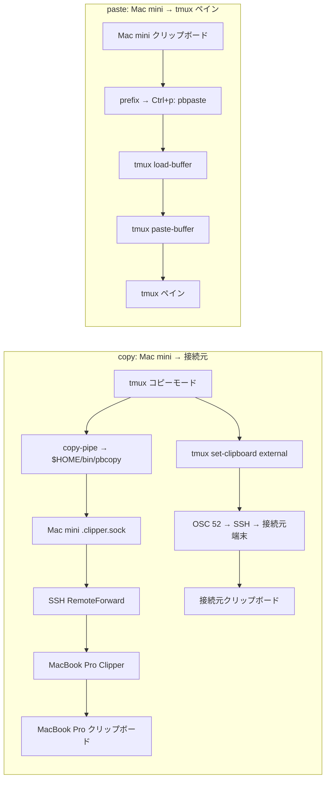
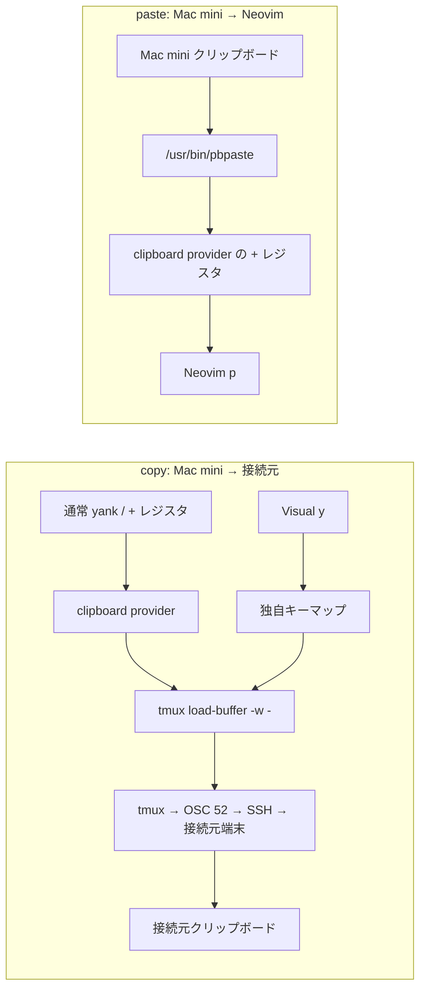
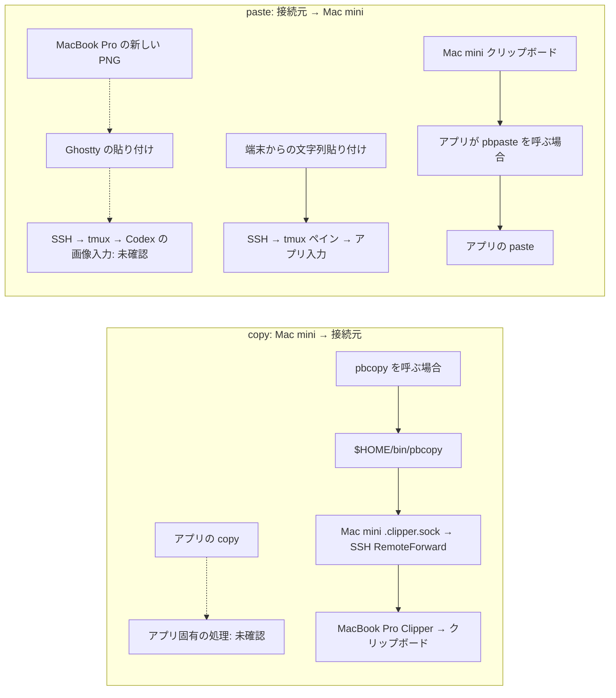

# ADR 0001: SSH 中の画像貼り付けと copy/yank を両立させる

- 日付: 2026-11-09、改定: 2026-11-10
- 状態: 検証中

## 目的

SSH 中に、接続元（host）から Mac mini（remote）への画像貼り付けと、Mac mini から接続元への copy/yank を、Neovim・tmux・Codex などで両立させる。文字列のコピーだけを成功条件としない。

## 現時点の決定

Mac mini では Clipper の導入と launchd 起動を復旧し、`dotfiles` の Clipper 対応 `pbcopy` を戻す。SSH 中の tmux と Neovim の copy/yank には引き続き OSC 52 を使う。Neovim の clipboard provider は copy を `tmux load-buffer -w -`、テキストの paste を macOS の `pbpaste` に分ける。tmux の `prefix → Ctrl+p` は従来どおり `pbpaste | tmux load-buffer - && tmux paste-buffer` とする。

これは両方向の実動作を検証するための暫定構成である。画像が以前どの経路を通っていたかは、旧コードと利用者の観測だけでは確定していない。Clipper の再導入が画像貼り付けを復旧したかどうかは、新しい PNG を使って確認する。

## 議論と経過

表の copy は Mac mini → 接続元、paste は接続元 → Mac mini。paste 欄は tmux の `prefix → Ctrl+p`、Neovim の `p`、Codex の画像添付など、各アプリ内の操作を指す。端末自身の貼り付けキーは別経路である。「未確認」は設定から結果を推測しないことを示す。

### 11月5日: 変更前（`dotfiles` commit `db47219`）

| 対象 | copy 経路 | copy 結果 | paste 経路 | paste 結果 |
| --- | --- | --- | --- | --- |
| tmux | `copy-pipe` → `pbcopy`。旧 `pbcopy` は条件が合えば Clipper ソケットへ送る。tmux の `set-clipboard` による OSC 52 も利用可能 | 接続元への到達は未確認 | `prefix → Ctrl+p` → Mac mini の `pbpaste` → tmux バッファ → ペイン | 接続元からの到達は未確認 |
| Neovim | `clipboard=unnamedplus` の macOS provider → `pbcopy`。Visual `y` は独自に `pbcopy` を呼ぶ | 接続元への到達は未確認 | `+` レジスタの macOS provider → `pbpaste` | 接続元からの到達は未確認 |
| Codex など | アプリ固有。旧 dotfiles は共通の copy を強制しない | 未確認 | アプリ固有。旧 dotfiles は画像入力を実装しない | この時点の個別結果は未確認 |

### 11月7日～Clipper 排除前（`dotfiles` commit `680bd6c` 以降）

| 対象 | copy 経路 | copy 結果 | paste 経路 | paste 結果 |
| --- | --- | --- | --- | --- |
| tmux | コピーモード → `$HOME/bin/pbcopy` → Clipper ソケットを優先。tmux の OSC 52 も利用可能 | 接続元へのコピーを利用者が報告 | `prefix → Ctrl+p` → Mac mini の `pbpaste` → tmux バッファ → ペイン | 設定は11月5日から不変。個別結果は未確認 |
| Neovim | macOS provider／Visual `y` → `pbcopy` → Clipper ソケットを優先 | 接続元への到達は未確認 | `+` レジスタ → `pbpaste` | 個別結果は未確認 |
| Codex など | アプリ固有 | 未確認 | アプリ固有の画像入力 | Ghostty（MacBook Pro）→ SSH → Mac mini → tmux → Codex で PNG 貼り付け成功を利用者が報告 |

### 11月9日: Clipper 排除後（`dotfiles` commit `d18004f`、`kickstart.nvim` commit `d59ffef`）

| 対象 | copy 経路 | copy 結果 | paste 経路 | paste 結果 |
| --- | --- | --- | --- | --- |
| tmux | コピーモードの OSC 52、および `pbcopy` → `tmux load-buffer -w -` | 接続元への文字列コピーを確認 | `prefix → Ctrl+p` → Mac mini の `pbpaste` → tmux バッファ → ペイン | 設定は不変。画像については未確認 |
| Neovim | SSH 中の `tmux` provider／Visual `y` → `tmux load-buffer -w -` → OSC 52 | Windows 11 で yank → 接続元への貼り付けを利用者が確認 | `tmux` provider → tmux バッファ。以前の `pbpaste` から変更された | 接続元からの paste は未確認 |
| Codex など | アプリ固有 | 未確認 | アプリ固有の画像入力 | 新しい PNG が届かないと利用者が報告。古い画像の添付は新しい転送の証拠にならない |

### 11月10日: Clipper 復旧と copy/paste 分離（現在の検証構成）

| 対象 | copy 経路 | copy 結果 | paste 経路 | paste 結果 |
| --- | --- | --- | --- | --- |
| tmux | OSC 52。`copy-pipe` の `pbcopy` は復旧した Clipper ソケットも使う | `pbcopy` → SSH ソケット転送 → MacBook Pro のクリップボードは文字列で確認済み。tmux コピーモードからの併用結果は未確認 | 従来どおり Mac mini の `pbpaste` → tmux バッファ → ペイン | 新しい画像と文字列で未確認 |
| Neovim | SSH 中は `tmux load-buffer -w -` → OSC 52。Visual `y` も同経路 | 新しい構成では未確認 | カスタム provider → Mac mini の `/usr/bin/pbpaste` | 新しい構成では未確認 |
| Codex など | アプリ固有 | 未確認 | アプリ固有の画像入力 | 新しい識別可能な PNG で未確認 |

### 現在の copy / paste 経路

MacBook Pro から Mac mini に SSH 接続した場合を描く。実線は設定から追える文字列の経路、点線はアプリ固有で実際の到達をまだ確認していない経路。`pbpaste` は Mac mini のクリップボードを読み、MacBook Pro のクリップボードを直接読み取るわけではない。

#### tmux

#### Neovim

#### その他のアプリ（Codex・シェルなど）

Mac mini では Clipper 3.0.0 を Homebrew から再導入し、launchd の `sh.brew.clipper` が `~/.clipper.sock` を待ち受けることを確認した。MacBook Pro 側にも Clipper 3.0.0 を導入した。MacBook Pro の SSH 設定には `Host mini` と `Host vpn` のそれぞれに Clipper 用 `RemoteForward` と `StreamLocalBindUnlink yes` があり、Mac mini の `sshd_config` にも `StreamLocalBindUnlink yes` がある。Mac mini 側で SSH が転送ソケットを待ち受け、Mac mini の `pbcopy` から MacBook Pro のクリップボードへの文字列到達を確認した。tmux 3.8、`set-clipboard external`、`Ms` 機能も確認済み。Clipper の公開文書は従来のソケット経路をテキスト向けと説明しているため、画像貼り付けとの因果関係は新しい画像で検証する。OSC 52 も文字列の copy 経路であり、単独で画像貼り付けを実現しない。

## 検証条件と残課題

- MacBook Pro で新しい識別可能な PNG をコピーし、Ghostty → SSH → tmux → Codex に貼り付ける。貼り付けた画像が新しいものであることを確認する。
- Mac mini の Clipper サービスとソケットの状態、Mac mini 側の画像クリップボードの変化を同時に確認し、転送経路を特定する。
- Windows 11 → Mac mini でも文字列・画像の貼り付けを確認する。Windows では Clipper の導入と SSH 設定をまだ行っていない。
- MacBook Pro 側の Clipper と SSH ソケット転送による文字列到達は確認済み。tmux・Neovim・Codex の各操作と画像貼り付けの結果を確認した後、最終構成をこの ADR に記録する。
- `tmux load-buffer -w` には tmux 3.2 以上と接続元端末の OSC 52 対応が必要。

## 参照

- [tmux Clipboard Wiki](https://github.com/tmux/tmux/wiki/Clipboard)
- [Neovim clipboard provider](https://neovim.io/doc/user/provider/)
- [Clipper](https://github.com/wincent/clipper)
